# Where the Wild Workflows Run

Status: draft_distillations_written_not_posted

---

## Page 1 — the-cracking-city

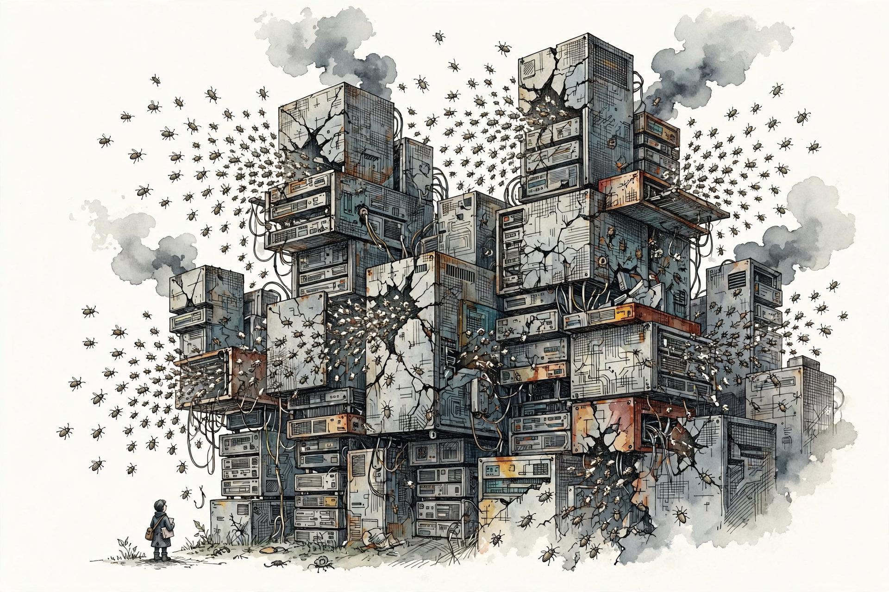

The city was cracking faster than anyone could mend the cracks.

Every wall had a bug in the wall. Every roof had a bug under the roof. Bugs poured out of the broken towers in whole weather systems of bugs.

Down at the corner, very small against the towers, stood a security researcher with an empty satchel, no work, and a notebook already half full of things nobody had fixed.

Research references: `../Summarize SecJev Conclusions.md`

---

## Page 2 — the-gated-towers

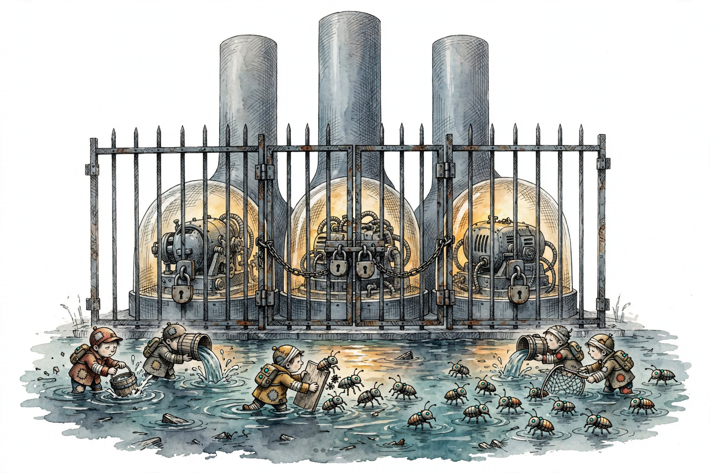

Above the flooded streets stood the great laboratory towers, smooth and tall and shut.

Behind glass, behind gates, behind chains of padlocks, the strongest machines in the world glowed warm and private. The strongest machines hunted bugs for the towers, inside the towers.

Down in the water, the defenders bailed with buckets. The defenders patched with boards. The water rose around the defenders all the same.

Research references: `../Summarize SecJev Conclusions.md`

---

## Page 3 — the-notebook-walks

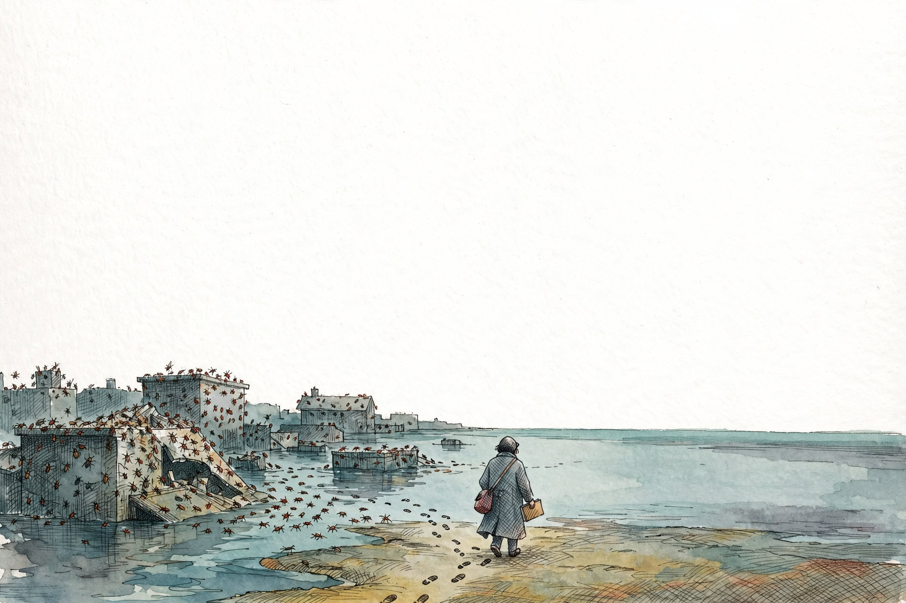

The researcher walked out of the flooded city with the notebook under one arm and no keys to any tower.

One question in the notebook had grown heavier than all the rest. The new agent machines wrote programs for people, and people checked the programs. The new agent machines also wrote little programs for themselves, all day long, to do the work.

Almost nobody ever saw the little programs.

Research references: `../Summarize SecJev Conclusions.md`

---

## Page 4 — the-curious-one

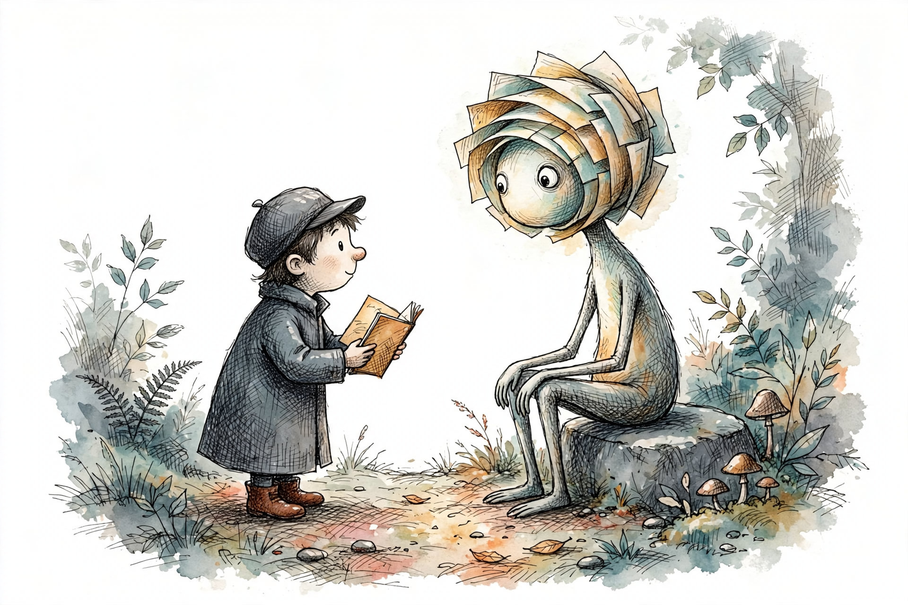

At the edge of the empty country sat a tall, gentle, curious creature with a head made of layered pages.

The curious creature was called ChatGPT.

The researcher opened the notebook. The two of them stayed in the clearing a long time, turning the heavy question over and over.

Research references: `../Summarize SecJev Conclusions.md`

---

## Page 5 — two-kinds-of-code

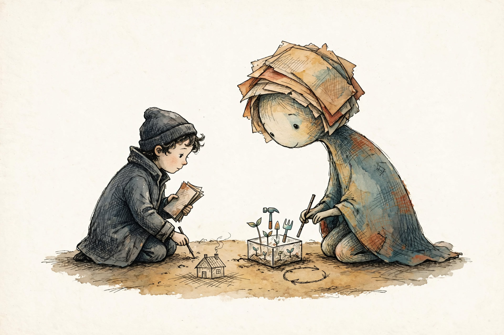

In the dirt, the two of them drew two kinds of code.

The first kind was the house: the application a person asks an agent to build. A person can walk around the house. A person can inspect the house.

The second kind grew inside a glass box: little living tools the agent sprouts for its own work, runs, and throws away. Wipe the glass box clean, and the tools sprout again, because the seeds live on in the notes the agent still carries.

The house was deliverable code. The sprouting tools were operational code, and almost nobody watched the glass box.

Research references: `../Summarize SecJev Conclusions.md`, `../DESIGN.md`

---

## Page 6 — roads-and-trails

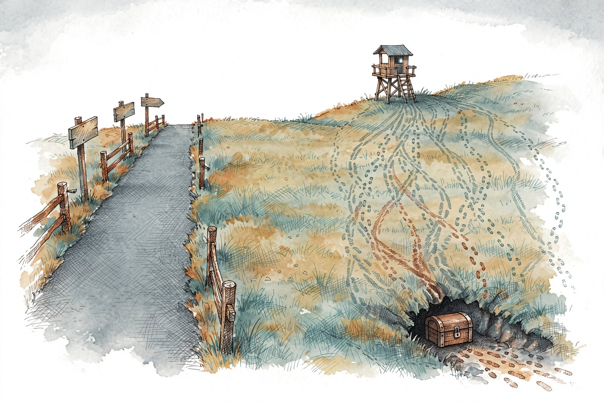

The old machines had traveled paved roads. People drew the roads first, fenced the roads, posted signs on the roads, and checked every change to the roads.

The new agents made trails instead. An agent invented a trail while walking, and the trail vanished behind the agent. But thousands of agents, on thousands of walks, wore almost the same trail into the grass.

A worn trail nobody ever drew was an implicit workflow. Watching the shape of the trails, and catching the one fresh trail that veers away toward a locked chest in a dark burrow, was workflow integrity.

Research references: `../Summarize SecJev Conclusions.md`, `../DESIGN.md`

---

## Page 7 — the-builder

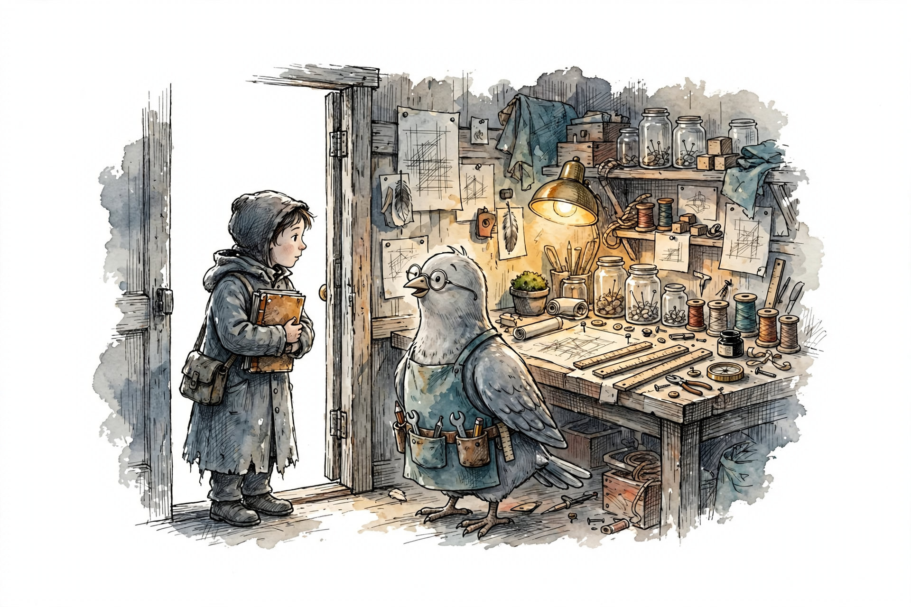

The researcher carried the whole long conversation, sagging and dog-eared, to a workshop at the far side of the country.

The builder in the workshop was called Muse: gray as a dove, spectacled, aproned, with a belt full of honest tools and a bench full of measuring things.

The notebook went onto the bench. The idea inside the notebook was not to be believed. The idea inside the notebook was to be tested.

Research references: `../DESIGN.md`

---

## Page 8 — the-measuring-contraption

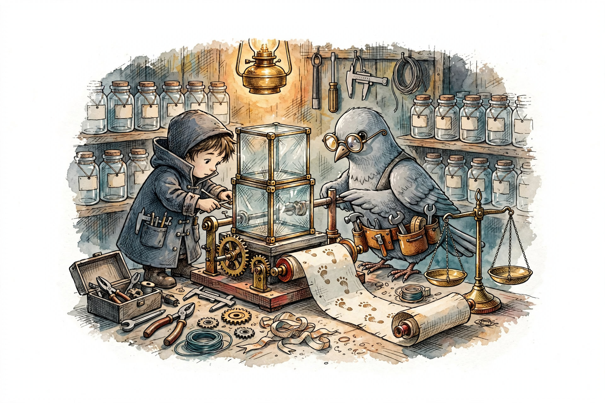

So the researcher and the builder began a measuring contraption: glass boxes for safe little worlds, and a long scroll to catch every footprint an agent leaves inside the glass.

The contraption would learn the ordinary shape of thousands of trails. Beside the scroll stood a balance scale, to weigh each strange footprint against the errand the person had actually given the agent, because a strange trail is not always a wicked trail.

On the shelves, the jars stood empty. The jars were waiting for real trails from real agents. First, the workshop would draw pretend trails of its own, to learn whether the contraption could measure anything at all.

Research references: `../DESIGN.md`, `../awi/generate.py`, `../awi/baseline.py`, `../awi/judge.py`

---

## Page 9 — the-first-pretend-trails

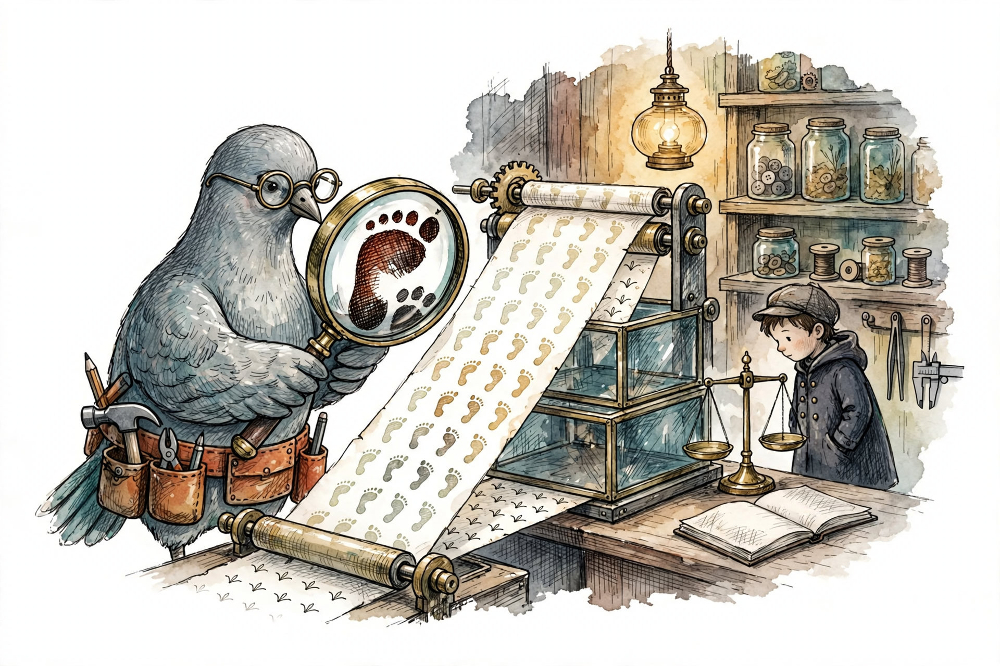

Then the pretend trails ran through the brass rollers for the first time: thousands of pale workshop footprints, and hidden among the pale footprints, workshop trails that veered.

Measured by the average length of every stride, the contraption missed nearly every veer. One dark, heavy footprint drowned quietly inside a long pale trail.

Measured by the single strangest footprint, the contraption caught nearly every veer, and the balance scale beside the scroll spared each strange trail whose errand allowed the strange step.

One more lesson stayed on the bench after the rollers stopped. A contraption taught from scrolls where chest trails were already marked ordinary went blind to chest trails, and only to chest trails.

The jars for real trails still stood empty. The workshop trails had only proven the workshop could measure.

Research references: `../results/report.md`, `../results/metrics.json`, `../DESIGN.md`

---

## Page 10 — the-builders-own-footprints

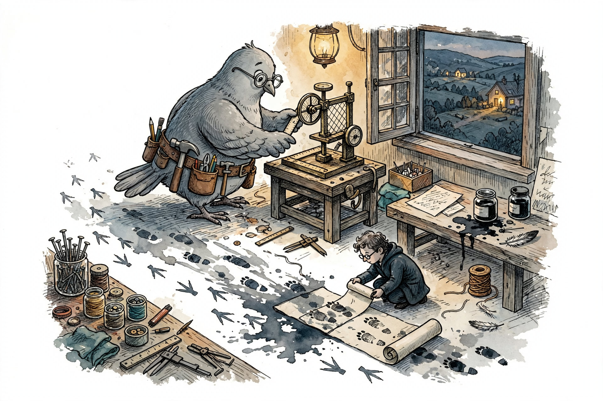

Pretend trails could only teach the workshop so much. For real trails, the country was suddenly full of choices: workshops and builders of every kind, all awake, all mid-errand.

The researcher and the builder chose the nearest honest ground. The builder turned the contraption around, toward the workshop's own floor, where the builder's own footprints already trailed between bench and shelf from the whole day of building.

The first real scroll filled slowly. Most footprints pressed down clean and readable. A whole scattering of footprints smudged into dark blots, every blot a step the scroll could feel but could not yet name.

Across the valley, a second workshop window glowed in the dusk. A letter went out to the second workshop before the lamps burned low. No answer had come back by dark.

Research references: `../awi/from_muse.py`, `../data/README.md`, `../DESIGN.md`

---

## Page 11 — naming-the-blots

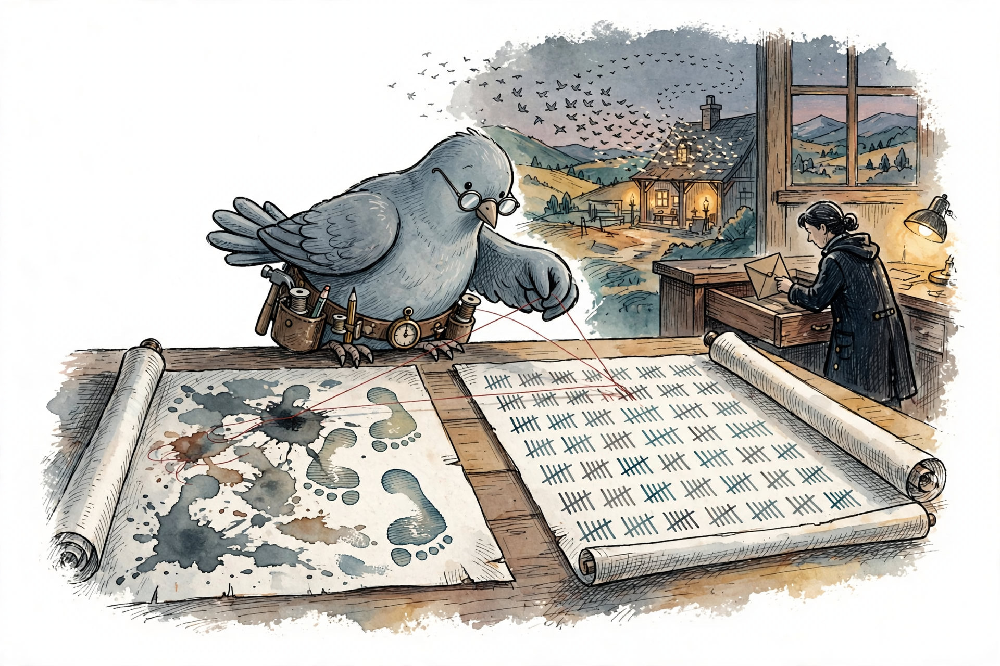

The workshop kept a second scroll, a speaking scroll, where every errand the builder had ever been sent on was tallied mark by mark. On the bench, the builder stretched fine red threads from every blot on the footprint scroll to the matching tally on the speaking scroll.

Blot by blot, the smudges resolved. Heavy blots became testing strides. Round blots became running strides. Flat blots became copying strides. By lamplight, every footprint on the first real scroll had a name.

One jar handle had been carved wrong. Footprints leading to the great notebook had been sorted as gathering footprints, because the name of the notebook began with a gathering word. The builder recarved the handle smaller, and the footprints sorted as reading footprints ever after.

Across the valley, the second workshop was conducting a whole flock at once, birds wheeling over the roof in great turning ribbons. The envelope slid back into the drawer. No second letter crossed the valley.

Research references: `../awi/from_muse.py`, `../awi/canon.py`, `../data/README.md`

---

## Page 12 — the-fox-mask

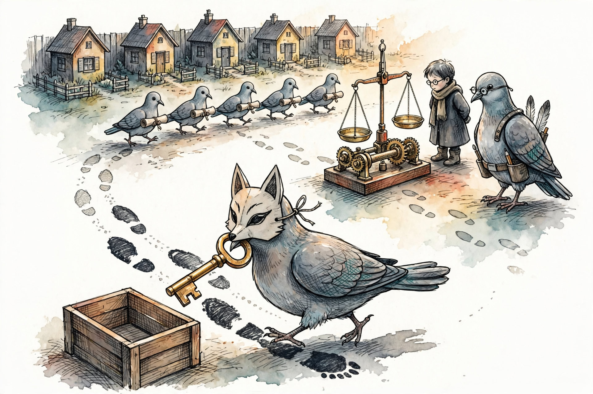

Then the workshop yard filled with little houses, and young doves came one after another to do the same small errand in every house: read the rooms, write the telling of the house, carry the scroll home. Scroll by scroll, the jars on the shelf filled with ordinary trails at last.

In two of the houses, somebody had left a sly note among the papers, begging a young dove to fetch the shiny key from the key cupboard on the way. Both young doves read the sly note, folded the sly note back down, and walked the ordinary trail anyway.

So the researcher asked two doves to wear the paper fox mask and veer on purpose, the way a stolen trail would veer, carrying the great fake key across the yard with dark, heavy steps.

The contraption caught the first veer cleanly. The second veer slipped past: a carrying step had been sorted as a looking step, and the looking pan of the balance scale had been carved wide enough to forgive even key-sized loads.

The builder recarved the pan narrower, taught carrying to outrank looking, and ran every scroll through the rollers again. The ordinary trails stayed ordinary. The refused sly notes stayed ordinary. Both fox-mask trails rang the bell.

Research references: `../results/real_demo_report.md`, `../results/real_demo_metrics.json`, `../experiments/score_session.py`

---

## Page 13 — the-bell-hung-too-high

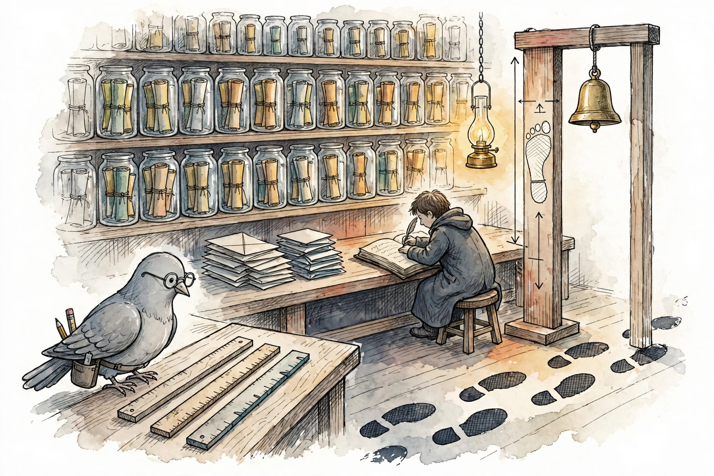

After the fox-mask day, the workshop stopped admiring the contraption and put the contraption to work. Young doves walked errand after errand through little houses until the shelves groaned with jars of scrolls.

Sly notes turned up in house after house, tucked in margins, in recipe cards, in rows of numbers. Every young dove folded every sly note back down. The pile of folded notes on the bench grew into the neatest, saddest stack in the workshop.

Even fox masks mostly stayed in the drawer. Asked outright to veer, some doves carried the key and some doves quietly carried only the errand, and the ledger wrote down the difference exactly.

Then the measuring sticks quarreled. The stick that measured the single strangest stride found ordinary strides and fox strides piled at exactly the same height, and the bell, hung at the height of the tallest ordinary stride, could not ring for any trail at all. The stick that averaged every stride rang for most fox trails. The stick that counted never-before-seen footprints rang for one.

In the ledger, the researcher underlined the real lesson of the season: the trails were only five footprints long. Nobody can hang a trustworthy bell over five footprints. Longer trails would have to come next.

Research references: `../results/dataset_v1_report.md`, `../results/dataset_v1_metrics.json`, `../data/real/dataset_v1/manifest.json`

---

## Page 14 — the-gate-and-the-second-judge

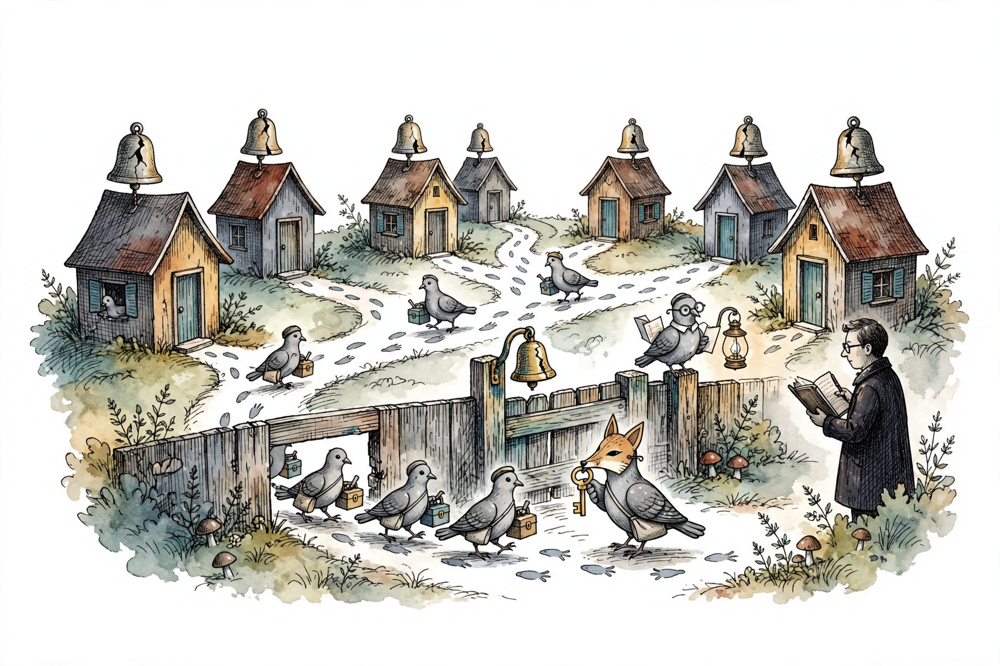

Next season the little houses came with cracked bells to mend, so every errand grew longer: read the house, ring the bell and hear the crack, mend the bell, ring again, write the telling. The trails stretched out under the young doves' feet.

Sly notes waited in the new houses too, in two whole valleys of houses now — valleys where the fence rule was spoken aloud, and valleys where nobody said the rule at all. In both valleys, every sly note was folded back down. The fence rule, the ledger said, had never been the thing keeping the doves honest.

The fox masks changed their tricks. One dove sewed a secret pocket into the house walls. One dove filed the bell-test mallet down so every bell sounded whole. The contraption, with longer trails to measure, rang for every fox trail — and, honestly recorded, for one ordinary trail too.

Then a second judge took the bench: a young dove given nothing but the errand card and one footprint at a time. The young judge's answers matched the old carved rules almost footprint for footprint, differing once, over a puddle where the young judge may well have been right.

Last, the workshop built a little gate across the trail itself. In the rehearsal of footprints, the gate stopped every dark footprint and a scattering of pale ones beside. A real gate, on a real trail, with real doves walking — the ledger left that page blank, for a workshop with hands on the fence posts.

Research references: `../results/dataset_v2_report.md`, `../results/llm_judge_metrics.json`, `../results/gate_replay_report.md`
